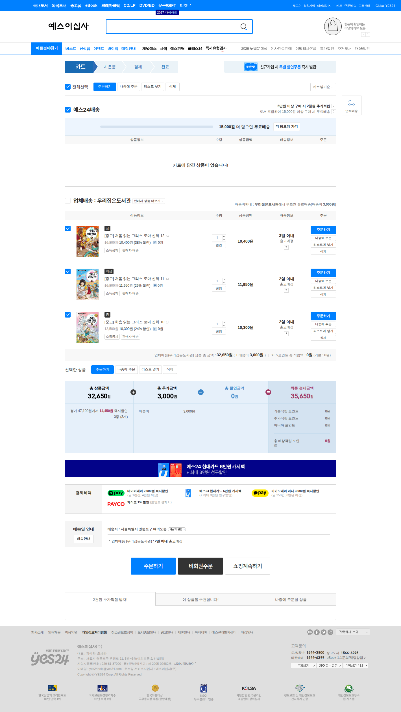

# 중고책 구매 계획 (2026-10-05)

조건: 등급 하 이상

**총액 35,650원** = 책값 32,650원 + 배송비 3,000원 · 주문처 1곳 · 최적화 Optimal

비교: 책마다 따로 최저가(배송비 포함)로 사면 40,150원 (주문처 3곳) → **4,500원 절약**

## 카트 대조

비회원 카트에 3건을 담았다. 카트 계산: 상품 32,650원 + 추가(배송비) 3,000원 = **최종 35,650원** → 계획과 **일치**

## 주문처별

### 우리집은도서관 (판매자 배송) — 책 32,650원 + 배송 3,000원

배송 조건: 배송비 : 3,000원, 우리집은도서관에서 직접 배송 · 만족도 4점(204명)

| 책 | 등급 | 가격 | 판매 건 |
|---|---|---:|---|
| 처음 읽는 그리스 로마 신화 10 | 중 | 10,300원 | [182970792](https://www.yes24.com/product/goods/182970792) |
| 처음 읽는 그리스 로마 신화 11 | 최상 | 11,950원 | [197305325](https://www.yes24.com/product/goods/197305325) |
| 처음 읽는 그리스 로마 신화 12 | 상 | 10,400원 | [197224844](https://www.yes24.com/product/goods/197224844) |

## 등급 조건별 최적 총액

| 최저 등급 | 총액 | 주문처 | 구성 |
|---|---:|---:|---|
| 하 이상 | 35,650원 | 1 | 우리집은도서관: 10(중 10,300), 11(최상 11,950), 12(상 10,400) |
| 중 이상 | 35,650원 | 1 | 우리집은도서관: 10(중 10,300), 11(최상 11,950), 12(상 10,400) |
| 상 이상 | 38,130원 | 2 | 북코치: 10(최상 10,500); YES24 목동점: 11(최상 14,280), 12(최상 10,850) |
| 최상 이상 | 38,130원 | 2 | 북코치: 10(최상 10,500); YES24 목동점: 11(최상 14,280), 12(최상 10,850) |

## 판본

### 처음 읽는 그리스 로마 신화 10

| | 상품번호 | 제목 | 출판사 · 출간 | 판매 건 |
|---|---|---|---|---|
| **사용** | [`120829116`](https://www.yes24.com/Product/UsedShopHub/Hub/120829116) | 처음 읽는 그리스 로마 신화 10 — 재주 많은 신과 인간들 | 미래엔아이세움 · 2023년 08월 | 매장ON 3 · 판매자 배송 24 |
|  | [`130300968`](https://www.yes24.com/Product/UsedShopHub/Hub/130300968) | 처음 읽는 그리스 로마 신화 1-10권 세트 (전 10권) — 미래엔아이세움 | 미래엔아이세움(전집) · 2020년 05월 | 판매자 배송 1 |
|  | [`197093951`](https://www.yes24.com/Product/UsedShopHub/Hub/197093951) | 처음 읽는 그리스 로마 신화1-10권세트 (전10권) | 아이세움 · 2025년 09월 | 판매자 배송 1 |
|  | [`196564297`](https://www.yes24.com/Product/UsedShopHub/Hub/196564297) | 처음 읽는 그리스 로마 신화 6~15 (전10권) | 미래엔아이세움 · 2024년 09월 | 판매자 배송 1 |
|  | [`193597404`](https://www.yes24.com/Product/UsedShopHub/Hub/193597404) | 처음 읽는 그리스 로마 신화 5~14 (전10권) | 미래엔아이세움 · 2024년 07월 | 판매자 배송 1 |
|  | [`165070807`](https://www.yes24.com/Product/UsedShopHub/Hub/165070807) | 처음 읽는 그리스로마신화1-10[전10권][미래앤아이세움]+[사은도서1권증정[비매품] | 미래앤아이세움 · 2024년 11월 | 판매자 배송 1 |
| | | … 외 8건 | | |

다른 판본을 쓰려면 목록에 `처음 읽는 그리스 로마 신화 10 = 상품번호`로 적는다.

### 처음 읽는 그리스 로마 신화 11

| | 상품번호 | 제목 | 출판사 · 출간 | 판매 건 |
|---|---|---|---|---|
| **사용** | [`125316473`](https://www.yes24.com/Product/UsedShopHub/Hub/125316473) | 처음 읽는 그리스 로마 신화 11 — 파리스의 선택 | 미래엔아이세움 · 2024년 03월 | 매장ON 4 · 판매자 배송 21 |
|  | [`196564160`](https://www.yes24.com/Product/UsedShopHub/Hub/196564160) | 처음 읽는 그리스 로마 신화 5~15 (전11권) | 미래엔아이세움 · 2024년 09월 | 판매자 배송 1 |
|  | [`193597399`](https://www.yes24.com/Product/UsedShopHub/Hub/193597399) | 처음 읽는 그리스 로마 신화 4~14 (전11권) | 미래엔아이세움 · 2024년 07월 | 판매자 배송 1 |
|  | [`165040490`](https://www.yes24.com/Product/UsedShopHub/Hub/165040490) | 처음 읽는 그리스로마신화1-11[전11권][미래앤아이세움]+[사은도서1권] | 미래앤 아이세움 · 2024년 11월 | 판매자 배송 1 |
|  | [`193690571`](https://www.yes24.com/Product/UsedShopHub/Hub/193690571) | 처음 읽는 그리스 로마 신화 11 12 13 14번 세트 (전4권) — [예쁜핸디노트+캐릭터 노트+펜 증정] | 미래엔아이세움(전집) · 2026년 03월 | 판매자 배송 1 |
|  | [`197093783`](https://www.yes24.com/Product/UsedShopHub/Hub/197093783) | 처음 읽는 그리스 로마 신화11 - 14권 세트(전4권) | 아이세움 · 2025년 09월 | 판매자 배송 1 |
| | | … 외 10건 | | |

다른 판본을 쓰려면 목록에 `처음 읽는 그리스 로마 신화 11 = 상품번호`로 적는다.

### 처음 읽는 그리스 로마 신화 12

| | 상품번호 | 제목 | 출판사 · 출간 | 판매 건 |
|---|---|---|---|---|
| **사용** | [`128874144`](https://www.yes24.com/Product/UsedShopHub/Hub/128874144) | 처음 읽는 그리스 로마 신화 12 — 트로이 전쟁 | 미래엔아이세움 · 2024년 07월 | 매장ON 5 · 판매자 배송 47 |
|  | [`139592986`](https://www.yes24.com/Product/UsedShopHub/Hub/139592986) | 처음 읽는 그리스 로마 신화 1-12권 세트 (전 12권) — 미래엔아이세움 | 미래엔아이세움(전집) · 2020년 05월 | 판매자 배송 1 |
|  | [`133977980`](https://www.yes24.com/Product/UsedShopHub/Hub/133977980) | 처음 읽는 그리스 로마 신화 1-12번 시리즈 (전12권) | 미래엔아이세움(전집) · 2024년 07월 | 판매자 배송 1 |
|  | [`196563478`](https://www.yes24.com/Product/UsedShopHub/Hub/196563478) | 처음 읽는 그리스 로마 신화 4~15 (전12권) | 미래엔아이세움 · 2024년 09월 | 판매자 배송 1 |
|  | [`193597396`](https://www.yes24.com/Product/UsedShopHub/Hub/193597396) | 처음 읽는 그리스 로마 신화 3~14 (전12권) | 미래엔아이세움 · 2024년 07월 | 판매자 배송 1 |
|  | [`193690571`](https://www.yes24.com/Product/UsedShopHub/Hub/193690571) | 처음 읽는 그리스 로마 신화 11 12 13 14번 세트 (전4권) — [예쁜핸디노트+캐릭터 노트+펜 증정] | 미래엔아이세움(전집) · 2026년 03월 | 판매자 배송 1 |
| | | … 외 8건 | | |

다른 판본을 쓰려면 목록에 `처음 읽는 그리스 로마 신화 12 = 상품번호`로 적는다.

## 참고

- 가격·재고는 조회 시점 기준. 결제 전 카트 금액으로 확인할 것
- 도서산간 추가 배송비, 쿠폰·포인트는 반영하지 않았다
